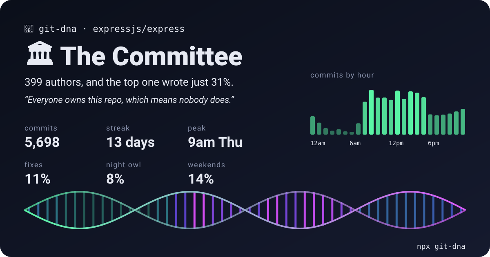
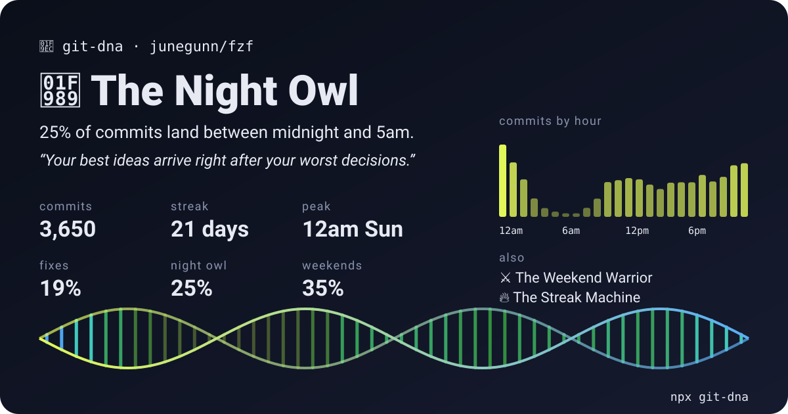
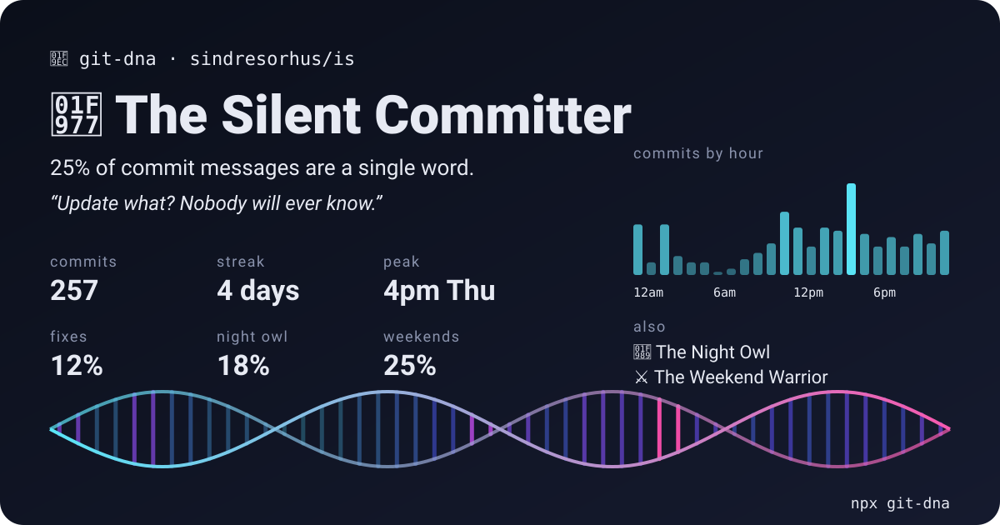

# git-dna

Reads a repository's commit history and tells you what kind of committer lives there.

```bash
npx git-dna
```



Run it in any git repository. It reads `git log` and prints:

- an archetype (Night Owl, Friday Deployer, Silent Committer, and so on) with the number that earned it
- commits by hour and by weekday, in the author's own timezone
- longest daily streak, biggest commit, shortest commit message, most common first word
- language mix by lines changed, share of fix commits, reverts

It also writes `git-dna.svg`, a 1200×630 card you can put in a README or attach to a post. The helix at the bottom is drawn from the repo's commit clock, so cards from different repos look different.

Nothing leaves your machine. There are no dependencies and no network calls. Node 18 or newer and git are all it needs.

## Examples

| junegunn/fzf | sindresorhus/is |
|---|---|
|  |  |

## Usage

```bash
git-dna                          # current repository
git-dna ../some-repo             # another repository
git-dna --me                     # only commits matching your git config user.email
git-dna --author "Ada Lovelace"  # only commits whose author name or email contains this text
git-dna --since 2025-01-01       # a year in review
git-dna --json                   # raw numbers, for scripts
git-dna --no-card                # terminal report only
git-dna --out card.svg           # write the card somewhere else
```

To show your card on your profile, commit it and reference it:

```md

```

## Archetypes

Each archetype has a threshold. The one the repo clears by the widest margin wins, and the next two are listed as traits. If nothing clears its threshold you get The Steady Hand. Under 10 commits you get The Hatchling, since there is not enough history to say anything.

| Archetype | Threshold |
|---|---|
| Night Owl | 15% of commits between midnight and 5am |
| Dawn Patrol | 12% of commits between 5am and 8am |
| Weekend Warrior | 25% of commits on Saturday or Sunday |
| Firefighter | 30% of messages mention a fix or bug |
| Friday Deployer | 10% of commits after 4pm on a Friday |
| Monolith Mover | 350 lines changed per commit on average |
| Surgeon | 18 lines or fewer per commit on average, with 30+ commits |
| Novelist | messages average 60+ characters |
| Silent Committer | 20% of messages are a single word |
| Streak Machine | a 21-day streak |
| 9-to-5 Professional | 90% of commits on weekdays between 9am and 6pm |

Merge commits are skipped. In a shallow clone only the fetched history is counted.

## Contributing

Ideas for new archetypes, better thresholds, or sharper one-liners are welcome as issues or pull requests.

## License

MIT
